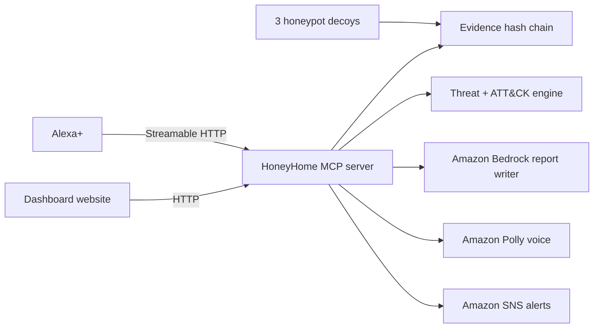

# HoneyHome

**Leave a trap. Catch the hacker.** A home network honeypot with an AI security analyst you talk to on Alexa+.

Track: **Alexa+** (self-hosted MCP server) · Mini challenge: **AWS Builder** (Amazon Bedrock + Amazon Polly + Amazon SNS)

## The idea

Big companies catch intruders with **honeypots**: fake, deliberately tempting devices that no real user would ever touch, so anyone who does is suspicious. HoneyHome brings that to the home, and puts an AI incident responder behind it that you talk to by voice.

It runs three decoys on your own network: a fake IP camera, a fake old router with a telnet login, and a fake file server. The moment anything connects, tries a login, or scans them, HoneyHome identifies the device, classifies the attack using the **MITRE ATT&CK** framework, seals the event in a tamper-evident hash chain, and alerts you through Alexa+ and a text message.

## What you can ask Alexa+

- *"Alexa, what's happening on my network?"* - a spoken summary of recent activity.
- *"Alexa, is my evidence intact?"* - verifies the forensic hash chain.
- *"Alexa, write me an incident report"* - a full professional report.
- *"Alexa, HoneyHome status"* - decoys armed, events and devices seen.

A high-severity event (like a default-password login) also speaks up on its own and sends a text via Amazon SNS.

## How it works



- **Honeypots** (`honeypots.py`): real TCP listeners on high ports (8081, 2323, 8445), so no admin rights are needed. They record every connection, login attempt and request. Nothing real is ever exposed.
- **Threat engine** (`threats.py`): detects brute force, factory-default logins, port scans and path traversal, and maps each to a MITRE ATT&CK technique ID.
- **Device fingerprinting** (`devices.py`): identifies the maker from the MAC address and flags random/spoofed addresses.
- **Evidence chain** (`evidence.py`): every event is a JSON line sealed with a SHA-256 hash of the record before it. Editing any old record breaks every later hash, which `verify_chain()` detects and pinpoints.
- **AI analyst** (`report.py`): Amazon Bedrock writes incident reports and summaries like a SOC analyst. Without Bedrock, a clear template report is produced instead.
- **Voice** (`voices.py`): Amazon Polly gives the analyst a natural voice; the dashboard falls back to a browser voice.
- **MCP server + dashboard** (`app.py`): one process serves the Alexa+ tools, the live dashboard, and its API.

### MCP tools

| Tool | What it does |
|---|---|
| `status` | Decoys armed, events and devices seen, evidence intact |
| `whats_happening` | Spoken summary of recent activity |
| `recent_activity` | The latest events, newest first |
| `check_evidence` | Verify the tamper-evident hash chain |
| `write_incident_report` | A full professional incident report |
| `name_device` | Give a device a friendly name for future alerts |

## Setup

Needs Python 3.10+.

```bash
git clone <your-repo-url>
cd honeyhome
python -m venv .venv
source .venv/bin/activate        # Windows: .venv\Scripts\activate
pip install -r requirements.txt
cp .env.example .env             # Windows: copy .env.example .env
python doctor.py                 # checks everything and tells you how to fix issues
python app.py
```

Then open http://localhost:8000 for the dashboard. The MCP endpoint for Alexa+ is at `/mcp`.

- **No AWS?** Set `DEMO_MODE=1` in `.env`. Everything runs, with template reports and a browser voice.
- **With AWS?** Run `aws configure`, enable your Bedrock model (Model access, same region as `AWS_REGION`), set `DEMO_MODE=0`. Polly and SNS use the same credentials.

## Seeing it work

- **Dashboard:** click **Launch a test attack**. It really connects to the honeypot ports, so every event is genuine. The feed, ATT&CK tags and evidence chain update live, and the analyst speaks the serious ones.
- **A real attack (great for the video):** open http://localhost:8081 in a browser and type `admin` / `admin`, or run `python demo_attack.py` from another terminal.
- **MCP test:** `python test_mcp.py` connects like Alexa+ would.

## Website

`docs/index.html` is a single file: a cinematic WebGL landing page (hand-written shader, hairline canvas overlay, one scroll-driven animation loop, no animation libraries) plus the live dashboard. Hosted on GitHub Pages it runs a self-contained demo; served by `app.py` it drives the real honeypots; opened on claude.ai it uses Claude to write live reports.

To host on GitHub Pages: repo **Settings > Pages**, source *Deploy from a branch*, branch `main`, folder `/docs`.

## Troubleshooting

Run `python doctor.py` first. Common things:

| Problem | Fix |
|---|---|
| `ModuleNotFoundError` | Activate the venv, then `pip install -r requirements.txt` |
| `No module named 'mcp.server.fastmcp'` | Old tutorial; this uses MCP SDK v2 (`MCPServer`) |
| A honeypot port won't bind | Something else uses 8081/2323/8445. Close it, or change the ports in `honeypots.py` |
| Dashboard says "template mode" | No AWS/Bedrock. Run `python doctor.py` to see why |
| No voice / robotic voice | Use Microsoft Edge for natural browser voices, or set up Polly |
| Text alert not arriving | New AWS accounts are in the SNS sandbox; verify the number in the SNS console |
| MCP client can't connect via tunnel | Put the tunnel host in `PUBLIC_HOST` in `.env` |

## Safety and ethics

HoneyHome only listens on your own machine and only records what connects to its own decoys. The decoys hold nothing real and expose no way in. Run it on a network you own.

## Built during the hackathon

All code here was written from scratch during the submission period.

## License

MIT, see `LICENSE`.
